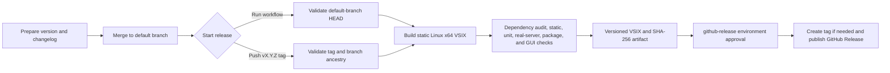

# CI and GitHub Releases

This project has three GitHub Actions workflows:

- `Continuous integration` (`.github/workflows/three-layer-tests.yml`) validates
  pushes, pull requests, and manual runs.
- `Dependency audit` (`.github/workflows/dependency-audit.yml`) audits npm
  dependencies on pushes, pull requests, manual runs, and a weekly schedule.
- `Release Linux x64 VSIX` (`.github/workflows/release.yml`) verifies a release
  candidate and publishes the supported Linux x64 package to GitHub Releases.

The release workflow does not publish to the Visual Studio Marketplace. No
Marketplace token is required.

## Continuous integration flow

CI runs three independent job groups. A newer run for the same branch or pull
request cancels the older run.

| Job | Platforms | Checks |
| --- | --- | --- |
| Quality | Linux, Windows, macOS | npm clean install, ESLint, TypeScript, Vitest unit tests; Linux also regenerates grammars/snippets and rejects drift |
| GUI | Linux, Windows, macOS; VS Code 1.82.3 and stable | Playwright workbench journey and `@vscode/test-electron` extension-host suite; failed-run logs and reports are uploaded |
| Real servers and package | Linux | Pinned, checksum-verified `llg_ls` and `softbrush_ls` release downloads, Linux x64 VSIX, unit and raw-stdio contracts, real VS Code/llg diagnostics in folder and standalone windows, archive validation including static linkage/mimalloc, real Softbrush startup/diagnostics, and SHA-256 artifact |

The real-server job does not build either server. `npm run stage:server`
and `npm run stage:softbrush` download the static musl Linux x64 assets of the
Lapligence and Softbrush GitHub releases pinned in `scripts/stage-server.ts`
and `scripts/stage-softbrush.ts`, and refuse any archive whose SHA-256 differs
from the value pinned there.

## Dependency audit

| Job | Runs on | Fails when |
| --- | --- | --- |
| npm audit | Every trigger | A registry signature or provenance attestation does not verify; any advisory affects a runtime dependency (bundled into the VSIX); or a critical advisory affects any dependency, including dev tooling |
| Dependency review | Pull requests | The pull request adds or changes a runtime dependency with a known advisory |

The full-tree `npm audit` report is written to the job summary even when it
passes, so high and moderate dev-tooling advisories stay visible. The weekly
run catches advisories published against an unchanged lockfile. Dependency
review needs the repository dependency graph enabled.

Fix findings with `npm audit fix` and commit the updated `package-lock.json`.
A finding that needs a breaking major upgrade is a regular change: upgrade and
test it like any other dependency bump.

## Release flow



The validation step requires all of the following:

- The version is valid semantic versioning and matches both `package.json` and
  `package-lock.json`.
- `CHANGELOG.md` has exactly one matching section with a valid `YYYY-MM-DD`
  release date instead of `Unreleased`.
- A manual run targets the current default-branch head.
- A pushed tag points to a commit contained in the default branch.
- If the tag already exists, it points to the exact commit being packaged.
- Registry signatures verify and no advisory affects a runtime dependency
  (`npm audit signatures`, `npm audit --omit=dev`).

The build-and-verify job has read-only repository permission. The publish job
is the only job with `contents: write`, and it is attached to the
`github-release` deployment environment. An existing GitHub Release is never
overwritten.

## One-time repository setup

1. Enable GitHub Actions for the repository.
2. In **Settings → Environments**, create an environment named
   `github-release`. Adding required reviewers is strongly recommended. If
   deployment branch/tag restrictions are enabled, allow the default branch
   and release tags matching `v*`.
3. Ensure repository or organization policy permits this workflow's
   `GITHUB_TOKEN` to request `contents: write`. No personal access token or
   repository secret is needed for GitHub Releases.
4. Optionally add branch protection or a ruleset requiring the
   `Continuous integration` checks before changes reach the default branch.

## Prepare a version

Run these commands from a clean checkout of the default branch. Replace
`0.2.1` with the intended version, without a leading `v`:

```sh
git pull --ff-only
npm ci
npm version 0.2.1 --no-git-tag-version --allow-same-version
```

Then change the matching changelog heading to a real release date, for example:

```text
## [0.2.1] - 2026-09-04
```

Review and commit `package.json`, `package-lock.json`, `CHANGELOG.md`, and any
intended source changes. Push them through the normal review process
and wait for CI to pass on the default branch.

Lapligence and Softbrush ship from their own GitHub releases, with their own
Rust CI and test policies. To move to a new server release, update `tag`,
`asset`, and `sha256` together in the matching stage script (the checksum is
published next to each asset as `<asset>.sha256`) and verify that release's
own CI was green. The extension release workflow exercises both downloaded
binaries through the raw-stdio contracts and the packaged-archive contract; it
does not duplicate either server's full test matrix.

For a local release-candidate check on Linux:

```sh
npm run build
git diff --exit-code -- package.json snippets/*.json syntaxes/*.json
npm audit signatures
npm audit --omit=dev
npm run lint
npm run typecheck
npm run test:unit
npm run package:linux-x64
REQUIRE_LLG=1 REQUIRE_SOFTBRUSH=1 npm run test:contract
npm run test:package
HDLSUPPORT_E2E_DISABLE_GPU=1 xvfb-run -a npm run test:e2e:playwright
HDLSUPPORT_E2E_DISABLE_GPU=1 xvfb-run -a npm run test:e2e:client-host
HDLSUPPORT_E2E_DISABLE_GPU=1 xvfb-run -a npm run test:e2e:real-server-host
HDLSUPPORT_E2E_DISABLE_GPU=1 xvfb-run -a npm run test:e2e:softbrush-host
```

## Publish manually from the GitHub UI

This is the recommended manual release path:

1. Open **Actions → Release Linux x64 VSIX → Run workflow**.
2. Select the repository's default branch.
3. Enter the exact package version without `v`, such as `0.2.1`.
4. Select **prerelease** only for a prerelease.
5. Start the workflow and, if configured, approve the `github-release`
   environment after the build-and-verify job succeeds.
6. Confirm that the resulting `v0.2.1` GitHub Release contains both
   `hdl-support-0.2.1-linux-x64.vsix` and its `.sha256` file.

The workflow creates the `v0.2.1` tag at the exact verified commit when the tag
does not already exist.

The equivalent GitHub CLI commands are:

```sh
gh workflow run release.yml --ref <default-branch> \
  -f version=0.2.1 \
  -f prerelease=false
gh run list --workflow release.yml --limit 1
gh run watch <run-id>
```

## Alternative: release by pushing a tag

After the version commit is on the default branch, an annotated tag can start
the same workflow:

```sh
git switch <default-branch>
git pull --ff-only
git tag -a v0.2.1 -m "HDL-Support 0.2.1"
git push origin v0.2.1
```

A SemVer prerelease tag such as `v0.3.0-rc.1` is automatically published as a
GitHub prerelease. Do not also start a manual workflow for the same version.

## Verify or recover a release

Download and verify the published files:

```sh
mkdir hdl-support-0.2.1-release
cd hdl-support-0.2.1-release
gh release download v0.2.1 --repo <owner>/<repository>
sha256sum --check hdl-support-0.2.1-linux-x64.vsix.sha256
code --install-extension hdl-support-0.2.1-linux-x64.vsix
```

If verification fails before publishing, fix the source or metadata on the
default branch and start a new manual run. If a tag-triggered run fails, delete
or move a published remote tag only after confirming that nobody relies on it;
otherwise prepare a new patch version. If publishing fails after the tag is
created, inspect the failed job before retrying—the workflow deliberately
refuses to replace an existing release.
