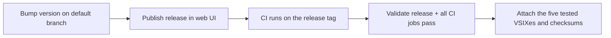

# CI and GitHub Releases

This project has two GitHub Actions workflows:

- `Continuous integration` (`.github/workflows/three-layer-tests.yml`) validates
  pushes, pull requests, and manual runs, and builds and tests one VSIX per
  supported target (linux-x64, linux-arm64, darwin-arm64, win32-x64,
  win32-arm64). When a GitHub Release is published from the web UI, it runs
  on the release's tag and its final job attaches the VSIXes that same run
  built and tested to that release.
- `Dependency audit` (`.github/workflows/dependency-audit.yml`) audits npm
  dependencies on pushes, pull requests, manual runs, and a weekly schedule.

Releases are not published to the Visual Studio Marketplace. No Marketplace
token is required.

## Continuous integration flow

CI runs these job groups. A newer run for the same branch or pull request
cancels the older run; release runs are never cancelled.

| Job | Platforms | Checks |
| --- | --- | --- |
| Quality | Linux, Windows, macOS | npm clean install, ESLint, TypeScript, Vitest unit tests; Linux also regenerates grammars/snippets and rejects drift |
| GUI | Linux, Windows, macOS; VS Code 1.82.3 and stable | Playwright workbench journey and `@vscode/test-electron` extension-host suite; failed-run logs and reports are uploaded |
| Real servers and VSIX | linux-x64, linux-arm64, darwin-arm64, win32-x64, win32-arm64 (native runners) | Builds the runner's platform VSIX from pinned, checksum-verified `llg_ls` and `softbrush_ls` release downloads and unpacks it; then runs the archive contract (Linux and macOS), raw-stdio contracts against the packaged servers, and real VS Code/llg diagnostics (folder and standalone windows) and Softbrush startup/diagnostics with VS Code loading the unpacked VSIX; uploads each VSIX with a SHA-256 file |
| Package contract (Windows) | Linux | Downloads the tested win32-x64 and win32-arm64 VSIXes and runs the archive contract that Windows runners cannot (no `unzip`/`zipinfo`) |
| Validate release, Attach VSIXes | Linux; release runs only | See [Release flow](#release-flow) |

The real-server job does not build either server. `npm run stage:server`
and `npm run stage:softbrush` download the runner's target assets of the
Lapligence and Softbrush GitHub releases pinned in `scripts/stage-server.ts`
and `scripts/stage-softbrush.ts`, and refuse any archive whose SHA-256 differs
from the value pinned there.

Real-server tests load the extension from the unpacked VSIX
(`HDLSUPPORT_E2E_EXTENSION_PATH`), so they exercise the minified production
bundle, the packaged file list, and the servers at their packaged paths. The
GUI job still runs the checkout against the fake server, because it scripts
server responses to cover client-only behavior. Each CI run's VSIXes can be
downloaded from its `vsix-<target>` artifacts.

## Dependency audit

| Job | Runs on | Fails when |
| --- | --- | --- |
| npm audit | Every trigger | A registry signature or provenance attestation does not verify; any advisory affects a runtime dependency (bundled into the VSIX); or a critical advisory affects any dependency, including dev tooling |
| Dependency review | Pull requests | The pull request adds or changes a runtime dependency with a known advisory |

The full-tree `npm audit` report is written to the job summary even when it
passes, so high and moderate dev-tooling advisories stay visible. The weekly
run catches advisories published against an unchanged lockfile. Dependency
review needs the repository dependency graph enabled.

Fix findings with `npm audit fix` and commit the updated `package-lock.json`.
A finding that needs a breaking major upgrade is a regular change: upgrade and
test it like any other dependency bump.

## Release flow

Releases are always created by hand in the GitHub web UI. The workflow never
creates releases or tags; it only tests the release's commit and attaches the
packages.



The `Validate release` job runs in parallel with the test jobs and requires
all of the following:

- The release tag is `v<version>`, the version is valid semantic versioning,
  and it matches both `package.json` and `package-lock.json`.
- The tag points to a commit contained in the default branch.
- Registry signatures verify and no advisory affects a runtime dependency
  (`npm audit signatures`, `npm audit --omit=dev`).

`Attach VSIXes to the release` needs every other job in the run, so nothing is
attached unless quality, GUI, real-server, and package checks all pass on
every platform. It downloads the run's `vsix-<target>` artifacts, verifies
their checksums, and uploads each VSIX and its `.sha256` file unchanged, under
the name it was built with. Packaging already uses the `<os>-<arch>` names of
the Lapligence and Softbrush release archives
(`hdl-support-<version>-linux-x86_64.vsix`, `-linux-arm64`, `-macos-arm64`,
`-windows-x86_64`, `-windows-arm64`). Re-running the job replaces those files.

Every other job has read-only repository permission; only the attach job has
`contents: write`.

## One-time repository setup

1. Enable GitHub Actions for the repository.
2. Ensure repository or organization policy permits the CI workflow's
   `GITHUB_TOKEN` to request `contents: write`. No personal access token or
   repository secret is needed.
3. Optionally add branch protection or a ruleset requiring the
   `Continuous integration` checks before changes reach the default branch.

## Prepare a version

Run these commands from a clean checkout of the default branch. Replace
`0.2.1` with the intended version, without a leading `v`:

```sh
git pull --ff-only
npm ci
npm version 0.2.1 --no-git-tag-version --allow-same-version
```

Review and commit `package.json`, `package-lock.json`, and any intended source
changes. Push them through the normal review process and wait for CI to pass
on the default branch. There is no `CHANGELOG.md`; release notes are written
in the web UI.

Lapligence and Softbrush ship from their own GitHub releases, with their own
Rust CI and test policies. To move to a new server release, update `tag` and
every target's `asset` and `sha256` together in the matching stage script (the checksum is
published next to each asset as `<asset>.sha256`) and verify that release's
own CI was green. This repository's CI exercises both downloaded binaries
through the raw-stdio contracts, the packaged-archive contract, and the real
VS Code suites; it does not duplicate either server's full test matrix.

For a local release-candidate check on Linux:

```sh
npm run build
git diff --exit-code -- package.json snippets/*.json syntaxes/*.json
npm audit signatures
npm audit --omit=dev
npm run lint
npm run typecheck
npm run test:unit
npm run package:linux-x64
REQUIRE_LLG=1 REQUIRE_SOFTBRUSH=1 npm run test:contract
npm run test:package
HDLSUPPORT_E2E_DISABLE_GPU=1 xvfb-run -a npm run test:e2e:playwright
HDLSUPPORT_E2E_DISABLE_GPU=1 xvfb-run -a npm run test:e2e:client-host
HDLSUPPORT_E2E_DISABLE_GPU=1 xvfb-run -a npm run test:e2e:real-server-host
HDLSUPPORT_E2E_DISABLE_GPU=1 xvfb-run -a npm run test:e2e:softbrush-host
```

## Publish a release

1. Open **Releases → Draft a new release**.
2. Choose a new tag `v0.2.1` (matching `package.json`) targeting the default
   branch.
3. Write the notes, or use **Generate release notes** to list merged pull
   requests grouped by label (`.github/release.yml`).
4. Tick **Set as a pre-release** if needed, then **Publish release**. A saved
   draft does not start CI; only publishing does.
5. Wait for the `Continuous integration` run on `v0.2.1`. When it passes, the
   release gains `hdl-support-0.2.1-<os>-<arch>.vsix` and its `.sha256` file
   for each of `linux-x86_64`, `linux-arm64`, `macos-arm64`, `windows-x86_64`,
   and `windows-arm64`.

Until that run finishes (or if it fails) the release has no VSIX files.

## Verify or recover a release

Download and verify the published files:

```sh
mkdir hdl-support-0.2.1-release
cd hdl-support-0.2.1-release
gh release download v0.2.1 --repo <owner>/<repository>
sha256sum --check hdl-support-0.2.1-*.vsix.sha256
code --install-extension hdl-support-0.2.1-linux-x86_64.vsix   # pick your platform's file
```

If a test job failed for a transient reason, use **Re-run failed jobs** on the
release's run; the attach job runs once everything passes. If the release
itself is wrong (version mismatch, broken commit), delete the release and its
tag only after confirming nobody relies on them, fix the default branch, and
publish again, or prepare a new patch version.
