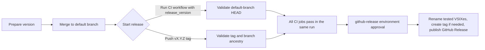

# CI and GitHub Releases

This project has two GitHub Actions workflows:

- `Continuous integration` (`.github/workflows/three-layer-tests.yml`) validates
  pushes, pull requests, and manual runs, and builds and tests one VSIX per
  supported target (linux-x64, linux-arm64, darwin-arm64, win32-x64,
  win32-arm64). On a `vX.Y.Z` tag push, or a manual run with a release
  version, its final job publishes those same tested VSIXes as a GitHub
  Release. Releasing never rebuilds or retests anything.
- `Dependency audit` (`.github/workflows/dependency-audit.yml`) audits npm
  dependencies on pushes, pull requests, manual runs, and a weekly schedule.

Releases are not published to the Visual Studio Marketplace. No Marketplace
token is required.

## Continuous integration flow

CI runs these job groups. A newer run for the same branch or pull request
cancels the older run; release runs are never cancelled.

| Job | Platforms | Checks |
| --- | --- | --- |
| Quality | Linux, Windows, macOS | npm clean install, ESLint, TypeScript, Vitest unit tests; Linux also regenerates grammars/snippets and rejects drift |
| GUI | Linux, Windows, macOS; VS Code 1.82.3 and stable | Playwright workbench journey and `@vscode/test-electron` extension-host suite; failed-run logs and reports are uploaded |
| Real servers and VSIX | linux-x64, linux-arm64, darwin-arm64, win32-x64, win32-arm64 (native runners) | Builds the runner's platform VSIX from pinned, checksum-verified `llg_ls` and `softbrush_ls` release downloads and unpacks it; then runs the archive contract (Linux and macOS), raw-stdio contracts against the packaged servers, and real VS Code/llg diagnostics (folder and standalone windows) and Softbrush startup/diagnostics with VS Code loading the unpacked VSIX; uploads each VSIX with a SHA-256 file |
| Package contract (Windows) | Linux | Downloads the tested win32-x64 and win32-arm64 VSIXes and runs the archive contract that Windows runners cannot (no `unzip`/`zipinfo`) |
| Validate release, Publish | Linux; release runs only | See [Release flow](#release-flow) |

The real-server job does not build either server. `npm run stage:server`
and `npm run stage:softbrush` download the runner's target assets of the
Lapligence and Softbrush GitHub releases pinned in `scripts/stage-server.ts`
and `scripts/stage-softbrush.ts`, and refuse any archive whose SHA-256 differs
from the value pinned there.

Real-server tests load the extension from the unpacked VSIX
(`HDLSUPPORT_E2E_EXTENSION_PATH`), so they exercise the minified production
bundle, the packaged file list, and the servers at their packaged paths. The
GUI job still runs the checkout against the fake server, because it scripts
server responses to cover client-only behavior. Each CI run's VSIXes can be
downloaded from its `vsix-<target>` artifacts.

## Dependency audit

| Job | Runs on | Fails when |
| --- | --- | --- |
| npm audit | Every trigger | A registry signature or provenance attestation does not verify; any advisory affects a runtime dependency (bundled into the VSIX); or a critical advisory affects any dependency, including dev tooling |
| Dependency review | Pull requests | The pull request adds or changes a runtime dependency with a known advisory |

The full-tree `npm audit` report is written to the job summary even when it
passes, so high and moderate dev-tooling advisories stay visible. The weekly
run catches advisories published against an unchanged lockfile. Dependency
review needs the repository dependency graph enabled.

Fix findings with `npm audit fix` and commit the updated `package-lock.json`.
A finding that needs a breaking major upgrade is a regular change: upgrade and
test it like any other dependency bump.

## Release flow



The `Validate release` job runs in parallel with the test jobs and requires
all of the following:

- The version is valid semantic versioning and matches both `package.json` and
  `package-lock.json`.
- A manual run targets the current default-branch head.
- A pushed tag points to a commit contained in the default branch.
- If the tag already exists, it points to the exact commit being packaged.
- Registry signatures verify and no advisory affects a runtime dependency
  (`npm audit signatures`, `npm audit --omit=dev`).

`Publish GitHub Release` needs every other job in the run, so nothing is
published unless quality, GUI, real-server, and package checks all pass on
every platform. It downloads the run's `vsix-<target>` artifacts, verifies
their checksums, renames them to the `<os>-<arch>` names of the Lapligence and
Softbrush release archives (`hdl-support-<version>-linux-x86_64.vsix`,
`-linux-arm64`, `-macos-arm64`, `-windows-x86_64`, `-windows-arm64`), and
writes a SHA-256 file for each.

Every other job has read-only repository permission. The publish job is the
only job with `contents: write`, and it is attached to the `github-release`
deployment environment. An existing GitHub Release is never overwritten.

## One-time repository setup

1. Enable GitHub Actions for the repository.
2. In **Settings → Environments**, create an environment named
   `github-release`. Adding required reviewers is strongly recommended. If
   deployment branch/tag restrictions are enabled, allow the default branch
   and release tags matching `v*`.
3. Ensure repository or organization policy permits the CI workflow's
   `GITHUB_TOKEN` to request `contents: write`. No personal access token or
   repository secret is needed for GitHub Releases.
4. Optionally add branch protection or a ruleset requiring the
   `Continuous integration` checks before changes reach the default branch.

## Prepare a version

Run these commands from a clean checkout of the default branch. Replace
`0.2.1` with the intended version, without a leading `v`:

```sh
git pull --ff-only
npm ci
npm version 0.2.1 --no-git-tag-version --allow-same-version
```

Review and commit `package.json`, `package-lock.json`, and any intended source
changes. Release notes are generated by GitHub from merged pull requests
(`--generate-notes`, configured in `.github/release.yml`); there is no
`CHANGELOG.md`. Push them through the normal review process
and wait for CI to pass on the default branch.

Lapligence and Softbrush ship from their own GitHub releases, with their own
Rust CI and test policies. To move to a new server release, update `tag` and
every target's `asset` and `sha256` together in the matching stage script (the checksum is
published next to each asset as `<asset>.sha256`) and verify that release's
own CI was green. This repository's CI exercises both downloaded binaries
through the raw-stdio contracts, the packaged-archive contract, and the real
VS Code suites; it does not duplicate either server's full test matrix.

For a local release-candidate check on Linux:

```sh
npm run build
git diff --exit-code -- package.json snippets/*.json syntaxes/*.json
npm audit signatures
npm audit --omit=dev
npm run lint
npm run typecheck
npm run test:unit
npm run package:linux-x64
REQUIRE_LLG=1 REQUIRE_SOFTBRUSH=1 npm run test:contract
npm run test:package
HDLSUPPORT_E2E_DISABLE_GPU=1 xvfb-run -a npm run test:e2e:playwright
HDLSUPPORT_E2E_DISABLE_GPU=1 xvfb-run -a npm run test:e2e:client-host
HDLSUPPORT_E2E_DISABLE_GPU=1 xvfb-run -a npm run test:e2e:real-server-host
HDLSUPPORT_E2E_DISABLE_GPU=1 xvfb-run -a npm run test:e2e:softbrush-host
```

## Publish manually from the GitHub UI

This is the recommended manual release path:

1. Open **Actions → Continuous integration → Run workflow**.
2. Select the repository's default branch.
3. Enter the exact package version without `v` as **release_version**, such as
   `0.2.1`. Leaving it empty runs CI without releasing.
4. Select **prerelease** only for a prerelease.
5. Start the workflow and, if configured, approve the `github-release`
   environment once every other job has passed.
6. Confirm that the resulting `v0.2.1` GitHub Release contains
   `hdl-support-0.2.1-<os>-<arch>.vsix` and its `.sha256` file for each of
   `linux-x86_64`, `linux-arm64`, `macos-arm64`, `windows-x86_64`, and
   `windows-arm64`. Release files use the `<os>-<arch>` names of the
   Lapligence and Softbrush release archives; locally built packages keep the
   VS Code target name (`hdl-support-<target>.vsix`).

The publish job creates the `v0.2.1` tag at the exact tested commit when the
tag does not already exist.

The equivalent GitHub CLI commands are:

```sh
gh workflow run three-layer-tests.yml --ref <default-branch> \
  -f release_version=0.2.1 \
  -f prerelease=false
gh run list --workflow three-layer-tests.yml --limit 1
gh run watch <run-id>
```

## Alternative: release by pushing a tag

After the version commit is on the default branch, an annotated tag starts a
CI run that releases once it passes:

```sh
git switch <default-branch>
git pull --ff-only
git tag -a v0.2.1 -m "HDL-Support 0.2.1"
git push origin v0.2.1
```

A SemVer prerelease tag such as `v0.3.0-rc.1` is automatically published as a
GitHub prerelease. Do not also start a manual workflow for the same version.

## Verify or recover a release

Download and verify the published files:

```sh
mkdir hdl-support-0.2.1-release
cd hdl-support-0.2.1-release
gh release download v0.2.1 --repo <owner>/<repository>
sha256sum --check hdl-support-0.2.1-*.vsix.sha256
code --install-extension hdl-support-0.2.1-linux-x86_64.vsix   # pick your platform's file
```

If a release run fails before publishing, fix the source or metadata on the
default branch and start a new manual run. If a tag-triggered run fails, delete
or move a published remote tag only after confirming that nobody relies on it;
otherwise prepare a new patch version. If publishing fails after the tag is
created, inspect the failed job before retrying—the workflow deliberately
refuses to replace an existing release.
